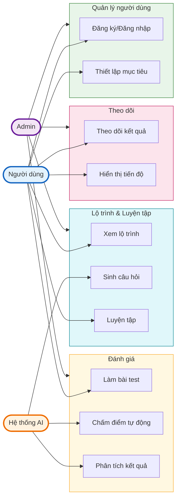
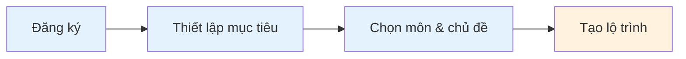
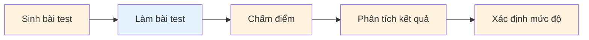
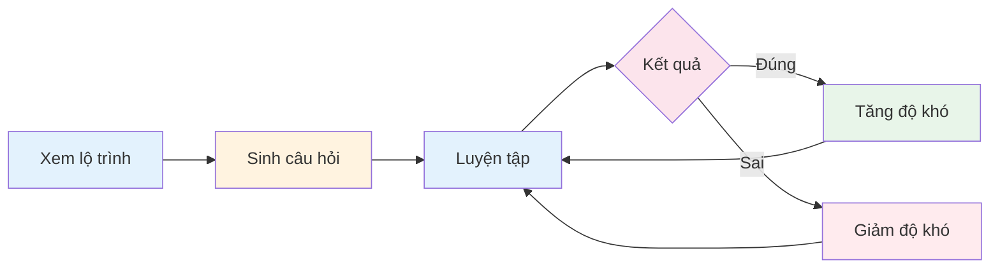
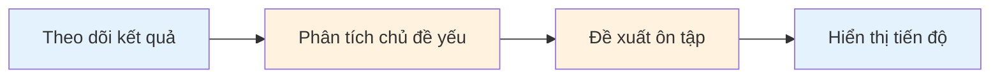
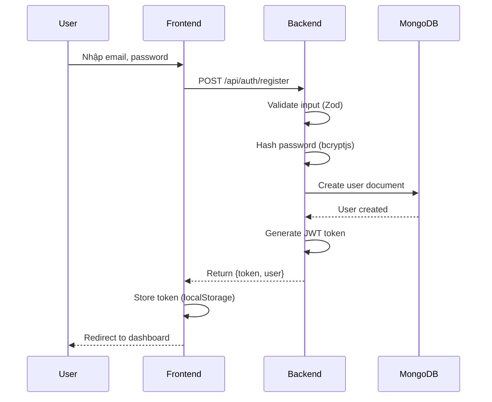
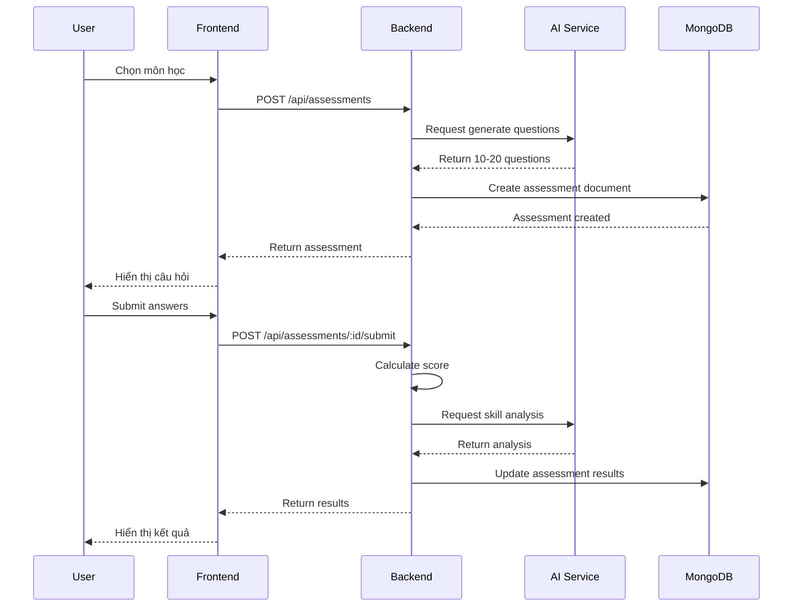
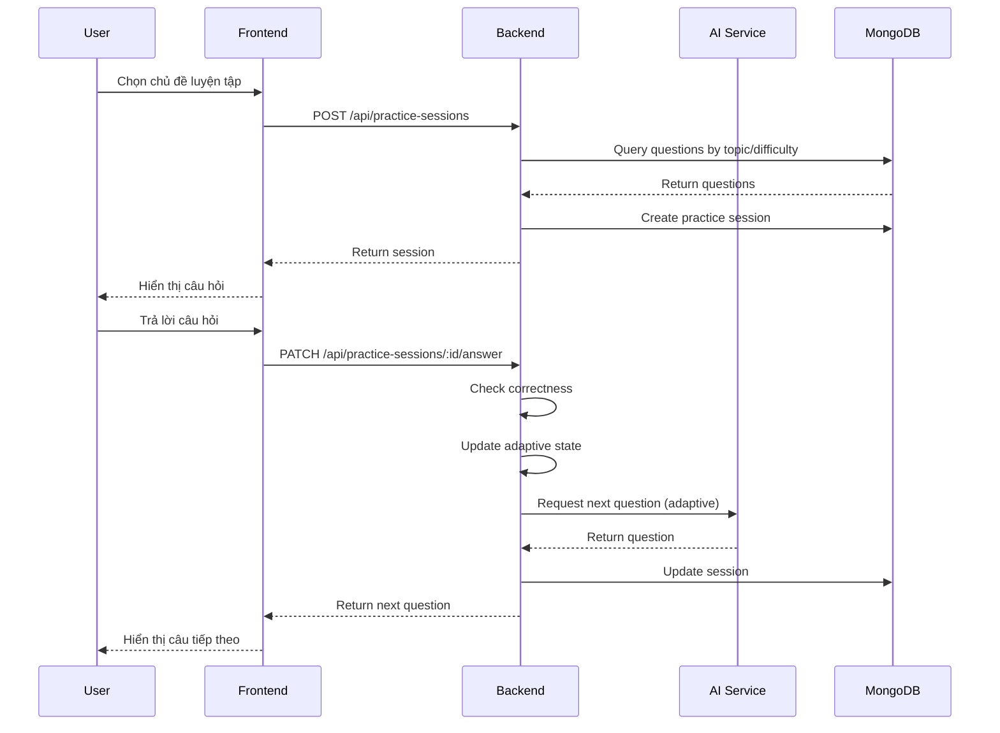

## 1. Phân Tích Yêu Cầu Hệ Thống

### 1.1 Yêu Cầu Chức Năng (Functional Requirements)

#### 1.1.1 Quản lý người dùng
| ID | Yêu cầu | Mức độ ưu tiên |
|----|---------|----------------|
| FR-001 | Đăng ký tài khoản mới | Cao |
| FR-002 | Đăng nhập/Đăng xuất | Cao |
| FR-003 | Cập nhật thông tin cá nhân | Trung bình |
| FR-004 | Thiết lập mục tiêu học tập | Cao |

#### 1.1.2 Đánh giá trình độ
| ID | Yêu cầu | Mức độ ưu tiên |
|----|---------|----------------|
| FR-005 | Sinh bài test đầu vào theo chủ đề | Cao |
| FR-006 | Chấm điểm tự động | Cao |
| FR-007 | Phân tích kết quả theo kỹ năng/chuyên đề | Cao |
| FR-008 | Xác định mức độ: Cơ bản - Trung bình - Nâng cao | Cao |

#### 1.1.3 Lộ trình học tập
| ID | Yêu cầu | Mức độ ưu tiên |
|----|---------|----------------|
| FR-009 | Tạo lộ trình học dựa trên mục tiêu | Cao |
| FR-010 | Phân chia nội dung theo tuần/ngày | Trung bình |
| FR-011 | Đề xuất nội dung cần tập trung | Cao |
| FR-012 | Gợi ý tài nguyên học phù hợp | Trung bình |

#### 1.1.4 Sinh câu hỏi & Luyện tập
| ID | Yêu cầu | Mức độ ưu tiên |
|----|---------|----------------|
| FR-013 | Sinh câu hỏi trắc nghiệm theo chủ đề | Cao |
| FR-014 | Điều chỉnh độ khó theo năng lực | Cao |
| FR-015 | Cung cấp đáp án và lời giải thích | Cao |
| FR-016 | Tạo đề luyện tập mô phỏng | Trung bình |

#### 1.1.5 Phân tích & Theo dõi
| ID | Yêu cầu | Mức độ ưu tiên |
|----|---------|----------------|
| FR-017 | Theo dõi kết quả từng bài làm | Cao |
| FR-018 | Xác định chủ đề sai nhiều | Cao |
| FR-019 | Đề xuất nội dung cần ôn tập lại | Trung bình |
| FR-020 | Hiển thị tiến độ cải thiện | Trung bình |

### 1.2 Yêu Cầu Phi Chức Năng (Non-Functional Requirements)

#### 1.2.1 Hiệu năng
| ID | Yêu cầu | Tiêu chí |
|----|---------|----------|
| NFR-001 | thời gian phản hồi API | < 2 giây |
| NFR-002 | thời gian sinh câu hỏi AI | < 5 giây |
| NFR-003 | Số người dùng đồng thời| > 100 users |
| NFR-004 | thời gian tải trang | < 3 giây |

#### 1.2.2 Bảo mật
| ID | Yêu cầu | Mô tả |
|----|---------|-------|
| NFR-005 | Mã hóa mật khẩu | bcrypt/argon2 |
| NFR-006 | JWT authentication | Token có thời hạn |
| NFR-007 | Bảo vệ API AI | Rate limiting, API key |
| NFR-008 | HTTPS | SSL/TLS encryption |

#### 1.2.3 Khả dụng & Mở rộng
| ID | Yêu cầu | Mô tả |
|----|---------|-------|
| NFR-009 | Uptime | > 99% |
| NFR-010 | Responsive design | Mobile, tablet, desktop |
| NFR-011 | Modular architecture | Dễ mở rộng tính năng |
| NFR-012 | Database scaling | Hỗ trợ sharding nếu cần |

#### 1.2.4 Trải nghiệm người dùng
| ID | Yêu cầu | Mô tả |
|----|---------|-------|
| NFR-013 | Giao diện thân thiện | Dễ sử dụng, intuitive |
| NFR-014 | Hỗ trợ tiếng Việt | Full Vietnamese support |
| NFR-015 | Offline mode | Cache kết quả tạm thời|
| NFR-016 | Accessibility | WCAG 2.1 Level AA |

---

## 2. Thiết Kế Sơ Đồ Use Case

### 2.1 Xác Định Các Actor

| Actor | Mô tả | Mục đích sử dụng hệ thống |
|-------|-------|---------------------------|
| **Người dùng (User)** | Học sinh/sinh viên sử dụng hệ thống để học tập | Đăng ký, làm bài test, học theo lộ trình, luyện tập |
| **Hệ thống AI (AI System)** | Hệ thống trí tuệ nhân tạo tích hợp | Sinh câu hỏi, chấm điểm, phân tích, đề xuất |
| **Admin** | Quản trị viên hệ thống | Quản lý người dùng, nội dung, theo dõi hệ thống |

### 2.2 Sơ Đồ Use Case Tổng Quan



**Mô tả sơ đồ:**
- **Người dùng (User):** Actor chính thực hiện các use case đăng ký, đăng nhập, làm bài test, xem lộ trình, luyện tập, theo dõi tiến độ
- **Hệ thống AI (AI System):** Actor phụ/hệ thống tự động sinh câu hỏi, chấm điểm, phân tích, đề xuất nội dung
- **Admin:** Quản trị viên quản lý toàn bộ hệ thống

---

### 2.3 Chi Tiết Từng Nhóm Use Case

#### 2.3.1 Quản lý người dùng (FR-001 đến FR-004)

| Use Case | Mô tả | Actor | Priority |
|----------|-------|-------|----------|
| UC-U01: Đăng ký tài khoản | Người dùng tạo tài khoản mới với email/số điện thoại | User | Cao |
| UC-U02: Đăng nhập/Đăng xuất | Xác thực và kết thúc phiên làm việc | User | Cao |
| UC-U03: Cập nhật thông tin | Chỉnh sửa hồ sơ cá nhân, ảnh đại diện | User | Trung bình |
| UC-U04: Thiết lập mục tiêu | Chọn môn học, chủ đề, thời gian đạt mục tiêu | User | Cao |

**Luồng chính - Đăng ký tài khoản:**
1. Người dùng truy cập trang đăng ký
2. Nhập thông tin: email, mật khẩu, họ tên
3. Hệ thống kiểm tra tính hợp lệ
4. Gửi email xác nhận (optional)
5. Tạo tài khoản thành công

#### 2.3.2 Đánh giá trình độ (FR-005 đến FR-008)

| Use Case | Mô tả | Actor | Priority |
|----------|-------|-------|----------|
| UC-A01: Sinh bài test đầu vào | AI tạo bài test theo chủ đề đã chọn | AI System | Cao |
| UC-A02: Làm bài test | Người dùng trả lời câu hỏi | User | Cao |
| UC-A03: Chấm điểm tự động | AI tính điểm ngay sau khi nộp | AI System | Cao |
| UC-A04: Phân tích kết quả | AI phân tích theo kỹ năng/chuyên đề | AI System | Cao |
| UC-A05: Xác định mức độ | Phân loại: Cơ bản/Trung bình/Nâng cao | AI System | Cao |

**Mối quan hệ:**
- UC-A01 → include → UC-A02 (Phải làm bài sau khi sinh)
- UC-A02 → include → UC-A03 (Chấm điểm sau khi làm)
- UC-A03 → extend → UC-A04 → extend → UC-A05 (Phân tích mở rộng từ chấm điểm)

#### 2.3.3 Lộ trình học tập (FR-009 đến FR-012)

| Use Case | Mô tả | Actor | Priority |
|----------|-------|-------|----------|
| UC-P01: Tạo lộ trình học | AI tạo lộ trình dựa trên mục tiêu và đánh giá | AI System | Cao |
| UC-P02: Phân chia nội dung | Chia nhỏ thành tuần/ngày học cụ thể | AI System | Trung bình |
| UC-P03: Xem lộ trình | Người dùng xem và theo dõi tiến độ | User | Cao |
| UC-P04: Đề xuất nội dung | AI gợi ý phần cần tập trung | AI System | Cao |
| UC-P05: Gợi ý tài nguyên | Đề xuất video, bài đọc, tài liệu | AI System | Trung bình |

**Luồng chính - Tạo lộ trình:**
1. Hệ thống nhận kết quả đánh giá đầu vào
2. Phân tích điểm mạnh/yếu
3. Tạo lộ trình cá nhân hóa
4. Phân chia nội dung theo thời gian
5. Đề xuất tài nguyên phù hợp

#### 2.3.4 Sinh câu hỏi & Luyện tập (FR-013 đến FR-016)

| Use Case | Mô tả | Actor | Priority |
|----------|-------|-------|----------|
| UC-Q01: Sinh câu hỏi trắc nghiệm | AI tạo câu hỏi theo chủ đề và độ khó | AI System | Cao |
| UC-Q02: Luyện tập | Người dùng làm bài luyện tập | User | Cao |
| UC-Q03: Điều chỉnh độ khó | AI tự động tăng/giảm độ khó theo năng lực | AI System | Cao |
| UC-Q04: Xem đáp án & giải thích | Hiển thị đáp án đúng và giải thích chi tiết | AI System | Cao |
| UC-Q05: Tạo đề luyện tập | Tạo bộ câu hỏi mô phỏng đề thi | AI System | Trung bình |

#### 2.3.5 Phân tích & Theo dõi (FR-017 đến FR-020)

| Use Case | Mô tả | Actor | Priority |
|----------|-------|-------|----------|
| UC-T01: Theo dõi kết quả | Lưu và hiển thị lịch sử bài làm | User, System | Cao |
| UC-T02: Xác định chủ đề yếu | AI phân tích chủ đề làm sai nhiều | AI System | Cao |
| UC-T03: Đề xuất ôn tập | Gợi ý nội dung cần ôn lại | AI System | Trung bình |
| UC-T04: Hiển thị tiến độ | Biểu đồ tiến độ cải thiện theo thời gian | User | Trung bình |

### 2.4 Sơ Đồ Use Case Chi Tiết - Luồng Chính

#### 2.4.1 Luồng Đăng ký & Thiết lập Mục tiêu



#### 2.4.2 Luồng Đánh giá Đầu vào



#### 2.4.3 Luồng Học tập & Luyện tập



#### 2.4.4 Luồng Theo dõi & Phân tích



**Chú thích màu:**
- Xanh nhạt (#e3f2fd): User thực hiện
- Cam nhạt (#fff3e0): AI/System thực hiện
- Hồng nhạt (#fce4ec): Quyết định/điều kiện
- Xanh lá nhạt (#e8f5e9): Thành công/tăng
- Đỏ nhạt (#ffebee): Thất bại/giảm

---

### 2.5 Ma Trận Actor-Use Case

| Use Case | Người dùng | AI System | Admin |
|----------|:---------:|:---------:|:-----:|
| Đăng ký/Đăng nhập | ● | | |
| Cập nhật thông tin | ● | | |
| Thiết lập mục tiêu | ● | | |
| Sinh bài test | | ● | |
| Làm bài test | ● | | |
| Chấm điểm tự động | | ● | |
| Phân tích kết quả | | ● | |
| Xác định mức độ | | ● | |
| Tạo lộ trình học | ○ | ● | |
| Phân chia nội dung | | ● | |
| Xem lộ trình | ● | | |
| Đề xuất nội dung | ○ | ● | |
| Sinh câu hỏi | | ● | |
| Luyện tập | ● | | |
| Điều chỉnh độ khó | ○ | ● | |
| Theo dõi kết quả | ● | ○ | |
| Xác định chủ đề yếu | | ● | |
| Đề xuất ôn tập | ○ | ● | |
| Hiển thị tiến độ | ● | | |

**Chú thích:** ● = Actor chính, ○ = Actor phụ

---

## 3. Thiết Kế Cơ Sở Dữ Liệu

### 3.1 Lựa Chọn Cơ Sở Dữ Liệu

Hệ thống sử dụng **MongoDB** (NoSQL Database) với các lý do sau:

| Tiêu chí | Lý do chọn MongoDB |
|----------|-------------------|
| **Schema linh hoạt** | Câu hỏi do AI sinh ra có cấu trúc đa dạng (trắc nghiệm, điền khuyết, tự luận). MongoDB cho phép lưu documents không đồng nhất trong cùng collection. |
| **Scalability** | Dự kiến lưu trữ hàng trăm nghìn câu hỏi. MongoDB dễ scale horizontally với sharding. |
| **JSON Native** | Dữ liệu lưu dạng BSON tương thích với JavaScript/TypeScript stack, không cần ORM phức tạp. |
| **Query Performance** | Indexing linh hoạt, hỗ trợ text search cho việc tìm kiếm câu hỏi. |
| **Development Speed** | Không cần định nghĩa schema cứng nhắc, phù hợp với quá trình phát triển Agile. |

### 3.2 Các Thực Thể Chính (Collections)

| Collection | Mô tả | Mối quan hệ | Ước tính số documents |
|------------|-------|-------------|----------------------|
| `users` | Thông tin người dùng, authentication, profile | - | ~10,000 |
| `subjects` | Môn học và danh sách chủ đề (topics) | topics (embedded) | ~10-20 |
| `questions` | Câu hỏi do AI sinh ra | reference: topic_ids | ~100,000+ |
| `assessments` | Bài test đầu vào và kết quả | reference: user_id, subject_id | ~50,000 |
| `learning_paths` | Lộ trình học cá nhân hóa | reference: user_id, assessment_id | ~10,000 |
| `practice_sessions` | Bài luyện tập và tiến độ | reference: user_id, question_ids | ~500,000 |

### 3.3 Sơ Đồ Quan Hệ Thực Thể (ERD)

**Xem sơ đồ trực tuyến:** [Mermaid Live Editor](https://mermaid.live/edit#pako:eNq1Vdty2jAQ_RWNngkT2yEEv1HqtPRCaAwvHWY8ir0Ytbbk6pKWAP_eNcHcTFoynepJ1tldnd09Ky9oLBOgPgX1lrNUsXwiCK5xGNyT5fLiQi5INwyDMPwcDEbEJ4Z9B123-RR07wf9wbto2B29R7MZO2E0vO_2Rv1eEJXx-ncDtItlXmRgqpDh-M2HoDeqHEZ3w35vbSUM4-K00QE9eGSZZS_FO2aZWp5Ups93bQy_jINwtGGI0VKp-FNluHdfab1c1sOCALUjsQ32chmshiTiYiL2irZ43pfr7uEbxKafkIgnZPhxB2ijuEgJ5IxnZFwHCqb1T6mSCPsx26FyHY8USk55BrtzphSbkwyYEugdpZJluuYVW6VAmCiDR8ie0VVFvKr3K7gLlkPtsBTlqXywW7HiheFSHLM2suCxPuKzLf05hPbiIKTJ7R7GhSEJn055bDMzr_Ey8wLqhULVYqFq5zkYljDDDqNbzVKIYmkrj20Se4I7J40tgKJSJXh7CtR2vTvGN_low4zVx6X5YUGXpa9rQoHGuhxX_3Au_jv3Lf7AynGSIkL1g9Z5qdbX5JnjUGgjBejDFuG8pJipjgpQMdT6VJvrf874T4rcZJDjpJzfJ9QdDs8jRGXi8Jc20gZNFU-ob5SFBs1B4TODn3Sd14SaGeDoUh-3CUwZek7oRJRuBRNfpcwrTyVtOqP-FF8T_LIFih82f5vtKT4pCaheKX_qu56zDkL9Bf1F_XaredX2Lr1W56bjtjzXa9A59R3PbbqO03LbN47retdX3qpBn9bXOs1Lt-PeONfOtetcdrx2a_UbV5UUbA)


**Chú thích ký hiệu:**
- `PK`: Primary Key (khóa chính)
- `FK`: Foreign Key (khóa ngoại)
- `UK`: Unique Key (duy nhất)
- `||--o{`: Quan hệ 1-nhiều (1 bên bắt buộc, nhiều bên tùy chọn)

### 3.4 Chi Tiết Schema Các Collection

#### 3.4.1 Collection: `users`
Lưu trữ thông tin ngườ dùng và cấu hình học tập.

```javascript
{
  _id: ObjectId,
  email: String,                    // Unique, indexed
  password_hash: String,            // bcrypt hashed
  profile: {
    name: String,
    avatar_url: String?,            // Optional
    grade: String?                  // "10", "11", "12", etc.
  },
  learning_goals: [{                // Mục tiêu học tập
    subject_id: ObjectId,           // ref: subjects
    target_level: String,           // "basic" | "intermediate" | "advanced"
    target_date: Date
  }],
  current_level: {                  // Cache kết quả đánh giá
    subject_id: ObjectId,
    level: String,
    weak_topics: [ObjectId]         // ref: subject.topics
  },
  created_at: Date,
  updated_at: Date
}
```

#### 3.4.2 Collection: `subjects`
Lưu trữ môn học và chủ đề con (embedded).

```javascript
{
  _id: ObjectId,
  name: String,                     // "Toán", "Lý", "Hóa"
  code: String,                     // Unique: "math", "physics"
  description: String,
  topics: [{                        // Embedded sub-documents
    _id: ObjectId,
    name: String,                   // "Đạo hàm", "Tích phân"
    parent_id: ObjectId?            // Cho nested topics
  }],
  created_at: Date,
  updated_at: Date
}
```

#### 3.4.3 Collection: `questions`
Lưu trữ câu hỏi do AI sinh ra.

```javascript
{
  _id: ObjectId,
  topic_ids: [ObjectId],            // ref: subject.topics
  difficulty: Number,               // 1 | 2 | 3 (cơ bản → nâng cao)
  type: String,                     // "multiple_choice" | "fill_blank" | "essay"
  content: {
    question_text: String,
    options: [{                      // Cho trắc nghiệm
      id: String,                   // "A", "B", "C", "D"
      text: String,
      is_correct: Boolean
    }],
    correct_answer: String,         // "A" hoặc text đáp án
    explanation: String             // AI giải thích
  },
  metadata: {
    generated_by: String,           // "claude" | "gpt"
    generation_prompt: String,      // Prompt đã dùng
    verified: Boolean               // Admin đã review?
  },
  usage_count: Number,              // Số lần dùng
  created_at: Date,
  updated_at: Date
}
```

#### 3.4.4 Collection: `assessments`
Bài test đầu vào đánh giá trình độ.

```javascript
{
  _id: ObjectId,
  user_id: ObjectId,                // ref: users
  subject_id: ObjectId,             // ref: subjects
  status: String,                   // "in_progress" | "completed"
  questions: [{                     // Embedded snapshot
    question_id: ObjectId,
    question_snapshot: Object,      // Copy từ questions
    user_answer: String?,
    is_correct: Boolean?,
    time_spent_seconds: Number?
  }],
  results: {
    score: Number,                  // 0-100
    correct_count: Number,
    total_questions: Number,
    skill_analysis: [{              // Phân tích theo topic
      topic_id: ObjectId,
      correct: Number,
      total: Number,
      level: String                 // "weak" | "average" | "strong"
    }],
    recommended_level: String       // "basic" | "intermediate" | "advanced"
  },
  completed_at: Date?,
  created_at: Date
}
```

#### 3.4.5 Collection: `learning_paths`
Lộ trình học cá nhân hóa.

```javascript
{
  _id: ObjectId,
  user_id: ObjectId,                // ref: users
  subject_id: ObjectId,             // ref: subjects
  based_on_assessment_id: ObjectId, // ref: assessments
  status: String,                   // "active" | "completed" | "paused"
  start_date: Date,
  target_date: Date,
  milestones: [{                    // Embedded milestones
    _id: ObjectId,
    title: String,                  // "Tuần 1: Đạo hàm cơ bản"
    topic_ids: [ObjectId],
    difficulty: Number,
    estimated_days: Number,
    resources: [{                   // Tài nguyên học
      type: String,                 // "video" | "article" | "exercise"
      title: String,
      url: String?
    }],
    completed_at: Date?,
    completion_rate: Number         // 0-100
  }],
  progress_percent: Number,         // 0-100
  created_at: Date,
  updated_at: Date
}
```

#### 3.4.6 Collection: `practice_sessions`
Bài luyện tập với adaptive difficulty.

```javascript
{
  _id: ObjectId,
  user_id: ObjectId,                // ref: users
  topic_ids: [ObjectId],            // Các topic đang luyện
  mode: String,                     // "adaptive" | "exam_simulation"
  settings: {
    question_count: Number,
    difficulty_range: [Number, Number],  // [1, 3]
    time_limit_minutes: Number?
  },
  questions: [{
    question_id: ObjectId,
    order: Number,
    user_answer: String?,
    is_correct: Boolean?,
    time_spent_seconds: Number?,
    hint_used: Boolean
  }],
  adaptive_state: {                 // Cho adaptive mode
    current_difficulty: Number,
    consecutive_correct: Number,
    consecutive_wrong: Number
  },
  results: {
    score: Number,
    accuracy_percent: Number,
    avg_time_per_question: Number,
    weak_topic_ids: [ObjectId]
  },
  status: String,                   // "in_progress" | "completed" | "abandoned"
  started_at: Date,
  completed_at: Date?,
  created_at: Date
}
```

### 3.5 Chiến Lược Index

```javascript
// users: unique email
users.createIndex({ email: 1 }, { unique: true });

// subjects: unique code
subjects.createIndex({ code: 1 }, { unique: true });
subjects.createIndex({ "topics._id": 1 });

// questions: query theo topic + difficulty
questions.createIndex({ topic_ids: 1, difficulty: 1 });
questions.createIndex({ difficulty: 1 });
questions.createIndex({ usage_count: -1 });  // Popular questions first
questions.createIndex({ "content.question_text": "text" });  // Text search

// assessments: query theo user
assessments.createIndex({ user_id: 1, created_at: -1 });
assessments.createIndex({ user_id: 1, subject_id: 1, status: 1 });

// learning_paths: query theo user + status
learning_paths.createIndex({ user_id: 1, status: 1 });

// practice_sessions: query theo user
practice_sessions.createIndex({ user_id: 1, started_at: -1 });
practice_sessions.createIndex({ user_id: 1, status: 1 });
```

### 3.6 Quyết Định Embed vs Reference

| Scenario | Quyết định | Lý do |
|----------|-----------|-------|
| Topics trong Subject | **Embed** | Topics thuộc về 1 subject, ít thay đổi, thường query cùng nhau. |
| Milestones trong LearningPath | **Embed** | 1 learning path có ~10-20 milestones, query atomic. |
| Questions trong Assessment | **Embed** | Assessment cần snapshot questions (để lưu history đúng/sai). |
| User trong các collections | **Reference** | User được dùng ở nhiều nơi, cần consistency. |
| Questions trong PracticeSession | **Reference** | Questions được reuse, cần update usage_count. |


---

## 4. Sơ Đồ Kiến Trúc Hệ Thống

### 4.1 Tổng Quan Kiến Trúc

Hệ thống sử dụng kiến trúc **3-tier** (3 lớp) với các thành phần chính:

```
┌─────────────────────────────────────────────────────────────────┐
│                        CLIENT LAYER                              │
│  ┌──────────────┐  ┌──────────────┐  ┌──────────────┐          │
│  │   Browser    │  │   Browser    │  │ Mobile App   │          │
│  │   (Web)      │  │   (Web)      │  │   (Future)   │          │
│  └──────┬───────┘  └──────┬───────┘  └──────┬───────┘          │
└─────────┼─────────────────┼─────────────────┼──────────────────┘
          │                 │                 │
          └─────────────────┴─────────────────┘
                            │ HTTPS
┌───────────────────────────▼─────────────────────────────────────┐
│                      API GATEWAY LAYER                           │
│  ┌──────────────────────────────────────────────────────────┐  │
│  │              Express.js REST API Server                   │  │
│  │  ┌────────────┐ ┌────────────┐ ┌────────────┐           │  │
│  │  │   Auth     │ │ Assessment │ │  Practice  │           │  │
│  │  │   Routes   │ │   Routes   │ │   Routes   │           │  │
│  │  └────────────┘ └────────────┘ └────────────┘           │  │
│  │  ┌────────────┐ ┌────────────┐ ┌────────────┐           │  │
│  │  │   Auth     │ │ Assessment │ │  Practice  │           │  │
│  │  │  Service   │ │  Service   │ │  Service   │           │  │
│  │  └────────────┘ └────────────┘ └────────────┘           │  │
│  └──────────────────────────────────────────────────────────┘  │
└───────────────────────────┬─────────────────────────────────────┘
                            │ Mongoose ODM
┌───────────────────────────▼─────────────────────────────────────┐
│                     DATA LAYER                                   │
│  ┌─────────────────┐  ┌─────────────────┐  ┌─────────────────┐  │
│  │    MongoDB      │  │   Redis Cache   │  │   AI Service    │  │
│  │   (Primary)     │  │   (Future)      │  │  (Claude/GPT)   │  │
│  └─────────────────┘  └─────────────────┘  └─────────────────┘  │
└─────────────────────────────────────────────────────────────────┘
```

### 4.2 Kiến Trúc Từng Thành Phần

#### 4.2.1 Frontend (Presentation Layer)

| Thành phần | Công nghệ | Mô tả |
|------------|-----------|-------|
| Framework | Next.js 15 | React framework với App Router, hỗ trợ SSR/SSG |
| Language | TypeScript | Type-safe development |
| Styling | Tailwind CSS v4 | Utility-first CSS framework |
| UI Components | shadcn/ui | Radix UI + Tailwind, accessible by default |
| State Management | React Context | Quản lý auth, user state |
| Data Fetching | Fetch API | Native fetch với async/await |

**Cấu trúc thư mục Frontend:**
```
frontend/
├── src/
│   ├── app/                    # Next.js App Router
│   │   ├── layout.tsx          # Root layout với providers
│   │   ├── page.tsx            # Landing page
│   │   ├── dashboard/          # Dashboard pages
│   │   │   ├── layout.tsx      # Dashboard shell
│   │   │   └── page.tsx        # Dashboard home
│   │   ├── auth/               # Auth pages
│   │   │   ├── login/
│   │   │   └── register/
│   │   └── assessment/         # Assessment flow
│   │
│   ├── components/
│   │   ├── ui/                 # shadcn/ui components
│   │   │   ├── button.tsx
│   │   │   ├── card.tsx
│   │   │   └── input.tsx
│   │   ├── auth/               # Auth-specific components
│   │   ├── dashboard/          # Dashboard components
│   │   └── assessment/         # Assessment components
│   │
│   ├── lib/
│   │   ├── utils.ts            # Utility functions (cn helper)
│   │   └── api.ts              # API client functions
│   │
│   ├── hooks/                  # Custom React hooks
│   │   └── useAuth.ts
│   │
│   └── types/                  # TypeScript types
│       └── index.ts
│
├── components.json             # shadcn/ui config
└── tailwind.config.ts
```

#### 4.2.2 Backend (Application Layer)

| Thành phần | Công nghệ | Mô tả |
|------------|-----------|-------|
| Runtime | Node.js | JavaScript runtime |
| Framework | Express.js | Web framework cho REST API |
| Language | TypeScript | Type-safe backend |
| Database | MongoDB | NoSQL document database |
| ODM | Mongoose | Object Data Modeling cho MongoDB |
| Auth | JWT | JSON Web Token cho authentication |
| Validation | Zod | Schema validation |
| Password Hash | bcryptjs | Bcrypt hashing |

**Cấu trúc thư mục Backend:**
```
backend/
├── src/
│   ├── config/
│   │   └── database.ts         # MongoDB connection
│   │
│   ├── middleware/
│   │   └── auth.middleware.ts  # JWT verification
│   │
│   ├── models/                 # Mongoose models
│   │   ├── user.model.ts
│   │   ├── subject.model.ts
│   │   ├── question.model.ts
│   │   ├── assessment.model.ts
│   │   ├── learning-path.model.ts
│   │   ├── practice-session.model.ts
│   │   └── index.ts
│   │
│   ├── routes/                 # API routes
│   │   ├── auth.routes.ts
│   │   ├── subject.routes.ts
│   │   ├── assessment.routes.ts
│   │   ├── practice.routes.ts
│   │   └── user.routes.ts
│   │
│   ├── services/               # Business logic
│   │   ├── auth.service.ts
│   │   ├── ai.service.ts
│   │   ├── assessment.service.ts
│   │   └── practice.service.ts
│   │
│   ├── types/                  # TypeScript interfaces
│   │   └── index.ts
│   │
│   ├── app.ts                  # Express app setup
│   └── server.ts               # Entry point
│
├── .env.example
├── package.json
└── tsconfig.json
```

#### 4.2.3 Database (Data Layer)

| Thành phần | Công nghệ | Mô tả |
|------------|-----------|-------|
| Primary DB | MongoDB | Document store cho dữ liệu ứng dụng |
| Cache (Future) | Redis | Session cache, rate limiting |
| File Storage (Future) | Cloud Storage | User avatars, attachments |

**Các Collections:**
- `users`: Authentication và profile
- `subjects`: Môn học và chủ đề
- `questions`: Câu hỏi AI-generated
- `assessments`: Bài test đầu vào
- `learning_paths`: Lộ trình học
- `practice_sessions`: Bài luyện tập

### 4.3 Luồng Dữ Liệu (Data Flow)

#### 4.3.1 Luồng Đăng Ký / Đăng Nhập



#### 4.3.2 Luồng Làm Bài Test Đầu Vào



#### 4.3.3 Luồng Luyện Tập



### 4.4 API Endpoints

#### Authentication
| Method | Endpoint | Description | Auth Required |
|--------|----------|-------------|---------------|
| POST | `/api/auth/register` | Đăng ký tài khoản | No |
| POST | `/api/auth/login` | Đăng nhập | No |
| GET | `/api/auth/me` | Lấy thông tin user hiện tại | Yes |

#### Subjects
| Method | Endpoint | Description | Auth Required |
|--------|----------|-------------|---------------|
| GET | `/api/subjects` | Danh sách môn học | No |
| GET | `/api/subjects/:id` | Chi tiết môn học | No |
| GET | `/api/subjects/:id/topics` | Danh sách chủ đề | No |

#### Assessments
| Method | Endpoint | Description | Auth Required |
|--------|----------|-------------|---------------|
| POST | `/api/assessments` | Tạo bài test mới | Yes |
| GET | `/api/assessments/:id` | Chi tiết bài test | Yes |
| POST | `/api/assessments/:id/submit` | Nộp bài test | Yes |
| GET | `/api/assessments` | Lịch sử bài test | Yes |

#### Practice
| Method | Endpoint | Description | Auth Required |
|--------|----------|-------------|---------------|
| POST | `/api/practice-sessions` | Tạo session luyện tập | Yes |
| GET | `/api/practice-sessions/:id` | Chi tiết session | Yes |
| PATCH | `/api/practice-sessions/:id/answer` | Trả lời câu hỏi | Yes |
| POST | `/api/practice-sessions/:id/complete` | Kết thúc session | Yes |

#### Learning Paths
| Method | Endpoint | Description | Auth Required |
|--------|----------|-------------|---------------|
| GET | `/api/learning-paths` | Danh sách lộ trình | Yes |
| GET | `/api/learning-paths/:id` | Chi tiết lộ trình | Yes |
| POST | `/api/learning-paths/:id/progress` | Cập nhật tiến độ | Yes |

### 4.5 Bảo Mật

| Layer | Biện pháp | Mô tả |
|-------|-----------|-------|
| Transport | HTTPS | Mã hóa kết nối client-server |
| Authentication | JWT | Token-based auth, expires in 7 days |
| Password | bcryptjs | Hash với salt rounds = 12 |
| Input Validation | Zod | Validate tất cả request body |
| CORS | cors middleware | Chỉ cho phép origin cụ thể |
| Rate Limiting | (Future) | express-rate-limit |

---

*Ngày tạo: 27/02/2026*

*Sinh viên: Trần Đỗ Lan Phương*
