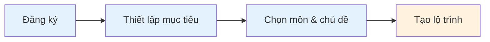
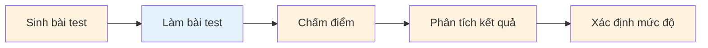
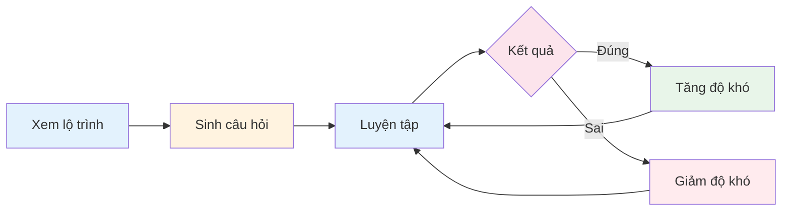
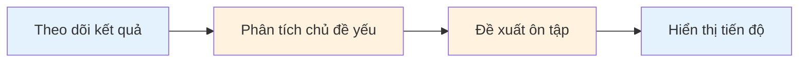

## 1. Phân Tích Yêu Cầu Hệ Thống

### 1.1 Yêu Cầu Chức Năng (Functional Requirements)

#### 1.1.1 Quản lý người dùng
| ID | Yêu cầu | Mức độ ưu tiên |
|----|---------|----------------|
| FR-001 | Đăng ký tài khoản mới | Cao |
| FR-002 | Đăng nhập/Đăng xuất | Cao |
| FR-003 | Cập nhật thông tin cá nhân | Trung bình |
| FR-004 | Thiết lập mục tiêu học tập | Cao |

#### 1.1.2 Đánh giá trình độ
| ID | Yêu cầu | Mức độ ưu tiên |
|----|---------|----------------|
| FR-005 | Sinh bài test đầu vào theo chủ đề | Cao |
| FR-006 | Chấm điểm tự động | Cao |
| FR-007 | Phân tích kết quả theo kỹ năng/chuyên đề | Cao |
| FR-008 | Xác định mức độ: Cơ bản - Trung bình - Nâng cao | Cao |

#### 1.1.3 Lộ trình học tập
| ID | Yêu cầu | Mức độ ưu tiên |
|----|---------|----------------|
| FR-009 | Tạo lộ trình học dựa trên mục tiêu | Cao |
| FR-010 | Phân chia nội dung theo tuần/ngày | Trung bình |
| FR-011 | Đề xuất nội dung cần tập trung | Cao |
| FR-012 | Gợi ý tài nguyên học phù hợp | Trung bình |

#### 1.1.4 Sinh câu hỏi & Luyện tập
| ID | Yêu cầu | Mức độ ưu tiên |
|----|---------|----------------|
| FR-013 | Sinh câu hỏi trắc nghiệm theo chủ đề | Cao |
| FR-014 | Điều chỉnh độ khó theo năng lực | Cao |
| FR-015 | Cung cấp đáp án và lờ giải thích | Cao |
| FR-016 | Tạo đề luyện tập mô phỏng | Trung bình |

#### 1.1.5 Phân tích & Theo dõi
| ID | Yêu cầu | Mức độ ưu tiên |
|----|---------|----------------|
| FR-017 | Theo dõi kết quả từng bài làm | Cao |
| FR-018 | Xác định chủ đề sai nhiều | Cao |
| FR-019 | Đề xuất nội dung cần ôn tập lại | Trung bình |
| FR-020 | Hiển thị tiến độ cải thiện | Trung bình |

### 1.2 Yêu Cầu Phi Chức Năng (Non-Functional Requirements)

#### 1.2.1 Hiệu năng
| ID | Yêu cầu | Tiêu chí |
|----|---------|----------|
| NFR-001 | thời gian phản hồi API | < 2 giây |
| NFR-002 | thời gian sinh câu hỏi AI | < 5 giây |
| NFR-003 | Số người dùng đồng thời| > 100 users |
| NFR-004 | thời gian tải trang | < 3 giây |

#### 1.2.2 Bảo mật
| ID | Yêu cầu | Mô tả |
|----|---------|-------|
| NFR-005 | Mã hóa mật khẩu | bcrypt/argon2 |
| NFR-006 | JWT authentication | Token có thời hạn |
| NFR-007 | Bảo vệ API AI | Rate limiting, API key |
| NFR-008 | HTTPS | SSL/TLS encryption |

#### 1.2.3 Khả dụng & Mở rộng
| ID | Yêu cầu | Mô tả |
|----|---------|-------|
| NFR-009 | Uptime | > 99% |
| NFR-010 | Responsive design | Mobile, tablet, desktop |
| NFR-011 | Modular architecture | Dễ mở rộng tính năng |
| NFR-012 | Database scaling | Hỗ trợ sharding nếu cần |

#### 1.2.4 Trải nghiệm người dùng
| ID | Yêu cầu | Mô tả |
|----|---------|-------|
| NFR-013 | Giao diện thân thiện | Dễ sử dụng, intuitive |
| NFR-014 | Hỗ trợ tiếng Việt | Full Vietnamese support |
| NFR-015 | Offline mode | Cache kết quả tạm thời|
| NFR-016 | Accessibility | WCAG 2.1 Level AA |

---

## 2. Thiết Kế Sơ Đồ Use Case

### 2.1 Xác Định Các Actor

| Actor | Mô tả | Mục đích sử dụng hệ thống |
|-------|-------|---------------------------|
| **Người dùng (User)** | Học sinh/sinh viên sử dụng hệ thống để học tập | Đăng ký, làm bài test, học theo lộ trình, luyện tập |
| **Hệ thống AI (AI System)** | Hệ thống trí tuệ nhân tạo tích hợp | Sinh câu hỏi, chấm điểm, phân tích, đề xuất |
| **Admin** | Quản trị viên hệ thống | Quản lý người dùng, nội dung, theo dõi hệ thống |

### 2.2 Sơ Đồ Use Case Tổng Quan

**Mô tả sơ đồ:**
- **Người dùng (User):** Actor chính thực hiện các use case đăng ký, đăng nhập, làm bài test, xem lộ trình, luyện tập, theo dõi tiến độ
- **Hệ thống AI (AI System):** Actor phụ/hệ thống tự động sinh câu hỏi, chấm điểm, phân tích, đề xuất nội dung
- **Admin:** Quản trị viên quản lý toàn bộ hệ thống

---

### 2.3 Chi Tiết Từng Nhóm Use Case

#### 2.3.1 Quản lý người dùng (FR-001 đến FR-004)

| Use Case | Mô tả | Actor | Priority |
|----------|-------|-------|----------|
| UC-U01: Đăng ký tài khoản | Người dùng tạo tài khoản mới với email/số điện thoại | User | Cao |
| UC-U02: Đăng nhập/Đăng xuất | Xác thực và kết thúc phiên làm việc | User | Cao |
| UC-U03: Cập nhật thông tin | Chỉnh sửa hồ sơ cá nhân, ảnh đại diện | User | Trung bình |
| UC-U04: Thiết lập mục tiêu | Chọn môn học, chủ đề, thời gian đạt mục tiêu | User | Cao |

**Luồng chính - Đăng ký tài khoản:**
1. Người dùng truy cập trang đăng ký
2. Nhập thông tin: email, mật khẩu, họ tên
3. Hệ thống kiểm tra tính hợp lệ
4. Gửi email xác nhận (optional)
5. Tạo tài khoản thành công

#### 2.3.2 Đánh giá trình độ (FR-005 đến FR-008)

| Use Case | Mô tả | Actor | Priority |
|----------|-------|-------|----------|
| UC-A01: Sinh bài test đầu vào | AI tạo bài test theo chủ đề đã chọn | AI System | Cao |
| UC-A02: Làm bài test | Người dùng trả lời câu hỏi | User | Cao |
| UC-A03: Chấm điểm tự động | AI tính điểm ngay sau khi nộp | AI System | Cao |
| UC-A04: Phân tích kết quả | AI phân tích theo kỹ năng/chuyên đề | AI System | Cao |
| UC-A05: Xác định mức độ | Phân loại: Cơ bản/Trung bình/Nâng cao | AI System | Cao |

**Mối quan hệ:**
- UC-A01 → include → UC-A02 (Phải làm bài sau khi sinh)
- UC-A02 → include → UC-A03 (Chấm điểm sau khi làm)
- UC-A03 → extend → UC-A04 → extend → UC-A05 (Phân tích mở rộng từ chấm điểm)

#### 2.3.3 Lộ trình học tập (FR-009 đến FR-012)

| Use Case | Mô tả | Actor | Priority |
|----------|-------|-------|----------|
| UC-P01: Tạo lộ trình học | AI tạo lộ trình dựa trên mục tiêu và đánh giá | AI System | Cao |
| UC-P02: Phân chia nội dung | Chia nhỏ thành tuần/ngày học cụ thể | AI System | Trung bình |
| UC-P03: Xem lộ trình | Người dùng xem và theo dõi tiến độ | User | Cao |
| UC-P04: Đề xuất nội dung | AI gợi ý phần cần tập trung | AI System | Cao |
| UC-P05: Gợi ý tài nguyên | Đề xuất video, bài đọc, tài liệu | AI System | Trung bình |

**Luồng chính - Tạo lộ trình:**
1. Hệ thống nhận kết quả đánh giá đầu vào
2. Phân tích điểm mạnh/yếu
3. Tạo lộ trình cá nhân hóa
4. Phân chia nội dung theo thời gian
5. Đề xuất tài nguyên phù hợp

#### 2.3.4 Sinh câu hỏi & Luyện tập (FR-013 đến FR-016)

| Use Case | Mô tả | Actor | Priority |
|----------|-------|-------|----------|
| UC-Q01: Sinh câu hỏi trắc nghiệm | AI tạo câu hỏi theo chủ đề và độ khó | AI System | Cao |
| UC-Q02: Luyện tập | Người dùng làm bài luyện tập | User | Cao |
| UC-Q03: Điều chỉnh độ khó | AI tự động tăng/giảm độ khó theo năng lực | AI System | Cao |
| UC-Q04: Xem đáp án & giải thích | Hiển thị đáp án đúng và giải thích chi tiết | AI System | Cao |
| UC-Q05: Tạo đề luyện tập | Tạo bộ câu hỏi mô phỏng đề thi | AI System | Trung bình |

#### 2.3.5 Phân tích & Theo dõi (FR-017 đến FR-020)

| Use Case | Mô tả | Actor | Priority |
|----------|-------|-------|----------|
| UC-T01: Theo dõi kết quả | Lưu và hiển thị lịch sử bài làm | User, System | Cao |
| UC-T02: Xác định chủ đề yếu | AI phân tích chủ đề làm sai nhiều | AI System | Cao |
| UC-T03: Đề xuất ôn tập | Gợi ý nội dung cần ôn lại | AI System | Trung bình |
| UC-T04: Hiển thị tiến độ | Biểu đồ tiến độ cải thiện theo thời gian | User | Trung bình |

### 2.4 Sơ Đồ Use Case Chi Tiết - Luồng Chính

#### 2.4.1 Luồng Đăng ký & Thiết lập Mục tiêu

#### 2.4.2 Luồng Đánh giá Đầu vào

#### 2.4.3 Luồng Học tập & Luyện tập

#### 2.4.4 Luồng Theo dõi & Phân tích

**Chú thích màu:**
- Xanh nhạt (#e3f2fd): User thực hiện
- Cam nhạt (#fff3e0): AI/System thực hiện
- Hồng nhạt (#fce4ec): Quyết định/điều kiện
- Xanh lá nhạt (#e8f5e9): Thành công/tăng
- Đỏ nhạt (#ffebee): Thất bại/giảm

---

### 2.5 Ma Trận Actor-Use Case

| Use Case | Người dùng | AI System | Admin |
|----------|:---------:|:---------:|:-----:|
| Đăng ký/Đăng nhập | ● | | |
| Cập nhật thông tin | ● | | |
| Thiết lập mục tiêu | ● | | |
| Sinh bài test | | ● | |
| Làm bài test | ● | | |
| Chấm điểm tự động | | ● | |
| Phân tích kết quả | | ● | |
| Xác định mức độ | | ● | |
| Tạo lộ trình học | ○ | ● | |
| Phân chia nội dung | | ● | |
| Xem lộ trình | ● | | |
| Đề xuất nội dung | ○ | ● | |
| Sinh câu hỏi | | ● | |
| Luyện tập | ● | | |
| Điều chỉnh độ khó | ○ | ● | |
| Theo dõi kết quả | ● | ○ | |
| Xác định chủ đề yếu | | ● | |
| Đề xuất ôn tập | ○ | ● | |
| Hiển thị tiến độ | ● | | |

**Chú thích:** ● = Actor chính, ○ = Actor phụ

---

## 3. Thiết Kế Cơ Sở Dữ Liệu

*(Đang cập nhật...)*

---

## 4. Sơ Đồ Kiến Trúc Hệ Thống

*(Đang cập nhật...)*

---

*Ngày tạo: 27/02/2026*

*Sinh viên: Trần Đỗ Lan Phương*
