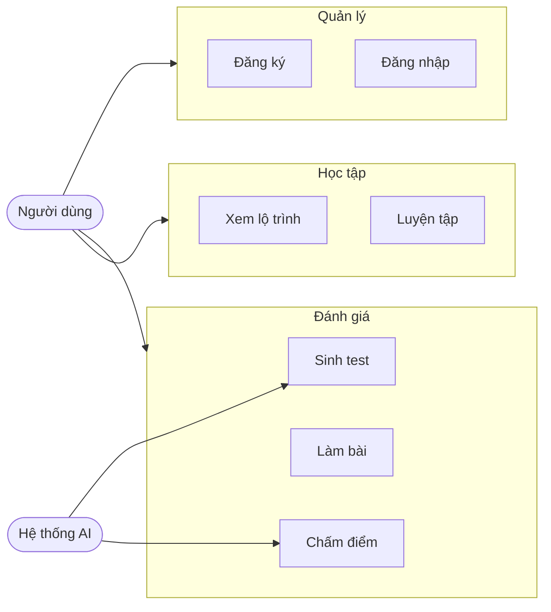

# BÁO CÁO TUẦN 1 — Phân tích yêu cầu hệ thống

| | |
|---|---|
| **Đề tài** | AI Learning Assistant — Web hỗ trợ học tập cá nhân hóa |
| **Sinh viên** | Trần Đỗ Lan Phương |
| **MSV** | B23DCCN667 |
| **Giảng viên hướng dẫn** | TS. Nguyễn Xuân Đức |
| **Tuần** | 1 |


---

## 1. Mục tiêu tuần

- Xác định bài toán và phạm vi của đồ án.
- Phân tích yêu cầu chức năng và phi chức năng.
- Lựa chọn công nghệ và phác thảo kiến trúc tổng thể.
- Thiết kế sơ bộ cơ sở dữ liệu và các API chính.
- Vẽ use case diagram để định hình các luồng người dùng.

---

## 2. Công việc đã thực hiện

### 2.1 Khảo sát bài toán
- Tìm hiểu nhu cầu cá nhân hóa học tập với 4 nhóm đối tượng: học sinh ôn THPT, người luyện IELTS, sinh viên học lập trình, người luyện tiếng Anh giao tiếp.
- Xác định 5 nhóm tính năng cốt lõi: quản lý tài khoản, đánh giá đầu vào, tạo lộ trình, luyện tập, phân tích tiến độ.

### 2.2 Phân tích yêu cầu chức năng (FR)

| Nhóm | Số yêu cầu | Ưu tiên cao |
|---|---|---|
| User Management | 4 (FR-001…004) | 3 |
| Assessment | 4 (FR-005…008) | 4 |
| Learning Path | 4 (FR-009…012) | 3 |
| Practice | 4 (FR-013…016) | 3 |
| Analytics | 4 (FR-017…020) | 2 |

Tổng cộng 20 yêu cầu chức năng được liệt kê và gán mức ưu tiên.

### 2.3 Phân tích yêu cầu phi chức năng (NFR)
- **Hiệu năng:** API response < 2s, AI sinh câu hỏi < 5s, page load < 3s.
- **Bảo mật:** bcrypt cho mật khẩu, JWT 7 ngày, HTTPS.
- **Khả năng mở rộng:** Thiết kế modular, responsive trên cả desktop và mobile.

### 2.4 Lựa chọn công nghệ

| Tầng | Công nghệ |
|---|---|
| Frontend | Next.js 15, React 19, TypeScript, Tailwind CSS v4, shadcn/ui |
| Backend | Express.js, TypeScript, Mongoose ODM |
| Database | MongoDB |
| AI Service | Claude API (mặc định) / OpenAI GPT |
| Auth | JWT + bcryptjs |
| Validation | Zod |

### 2.5 Thiết kế cơ sở dữ liệu

6 collection chính: `users`, `subjects`, `questions`, `assessments`, `learning_paths`, `practice_sessions`.

Quan hệ chính:
```
User 1—* Assessment
User 1—* LearningPath
User 1—* PracticeSession
Subject 1—* Topic (embedded)
Subject 1—* Question
Assessment 1—* Question (embedded snapshot)
```

### 2.6 Use Case Diagram



### 2.7 Kiến trúc tổng thể

```
Frontend (Next.js) ──REST API──► Backend (Express) ──► MongoDB
                                       │
                                       └─► Claude API (AI)
```

---

## 3. Kết quả đạt được

- Tài liệu phân tích yêu cầu hoàn chỉnh với 20 FR + 8 NFR.
- Schema database và 3 endpoint khởi tạo (`/api/auth/register`, `/login`, `/me`) được lên kế hoạch.
- Use case diagram cấp tổng thể.
- Khẳng định stack công nghệ.

---

## 4. Khó khăn / Vấn đề gặp phải

- **Phạm vi rộng:** 4 đối tượng người dùng yêu cầu rất khác nhau (THPT vs IELTS vs lập trình). Đã giải quyết bằng cách trừu tượng hóa thành Subject/Topic và để AI tự thích ứng nội dung qua prompt.
- **Phân vân giữa Claude và GPT:** Quyết định ưu tiên Claude (chất lượng tiếng Việt tốt) nhưng kiến trúc thiết kế qua interface `IAIProvider` cho phép thay thế dễ dàng.

---

## 5. Hướng tuần tiếp theo

- Khởi tạo dự án backend (Express + TypeScript).
- Cấu hình MongoDB + Mongoose.
- Cài đặt JWT authentication và 3 endpoint auth.
- Thiết lập Swagger UI cho tài liệu API.
