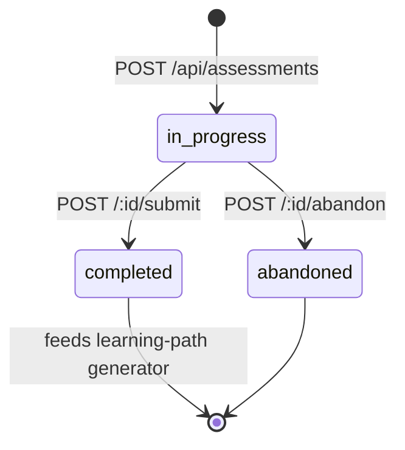
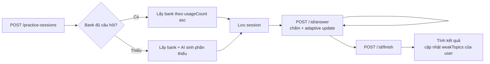

# BÁO CÁO TUẦN 4 — Hoàn thiện backend API

| | |
|---|---|
| **Đề tài** | AI Learning Assistant — Web hỗ trợ học tập cá nhân hóa |
| **Sinh viên** | Trần Đỗ Lan Phương |
| **MSV** | B23DCCN667 |
| **Giảng viên hướng dẫn** | TS. Nguyễn Xuân Đức |
| **Tuần** | 4 |


---

## 1. Mục tiêu tuần

- Hoàn tất 4 nhóm endpoint còn lại để backend sẵn sàng cho frontend.
- Thêm Subject catalog (chỉ đọc), Assessment lifecycle, Practice Session lifecycle, User Profile + đổi credential.
- Cài đặt cơ chế chống "1 bài đang làm dở" cho assessment và practice.
- Đơn giản hóa hệ thống về duy nhất loại câu hỏi trắc nghiệm.

---

## 2. Công việc đã thực hiện

Tuần 4 chia thành 6 phase nhỏ, mỗi phase build & test độc lập trước khi chuyển sang phase tiếp theo.

### 2.1 Phase 1 — Subject catalog (seed + đọc)

- Tạo script `seed-subjects.ts` chạy bằng `npm run seed:subjects`.
- Idempotent: chạy lại không tạo trùng, không đổi `_id` của topic (đảm bảo tương thích ngược cho Question/Assessment đã tham chiếu topic).
- Catalog 4 môn: Toán THPT, IELTS, Lập trình Python, Tiếng Anh giao tiếp.
- 2 endpoint công khai: `GET /api/subjects`, `GET /api/subjects/:id`.

### 2.2 Phase 2 — Đơn giản hóa loại câu hỏi

Loại bỏ `fill_blank` và `essay` khỏi 6 file (`types`, `model`, `controller`, `service`, `routes`). Cả hệ thống chỉ còn `multiple_choice`. Lý do: chấm điểm tự luận cần AI rubric phức tạp, nằm ngoài phạm vi đồ án; loại trắc nghiệm đủ thể hiện đầy đủ quy trình AI sinh câu hỏi → chấm tự động → phân tích.

### 2.3 Phase 3 — Assessment API



| Method | Endpoint | Chức năng |
|---|---|---|
| POST | `/api/assessments` | Tạo bài test (sinh câu hỏi qua AI) |
| GET | `/api/assessments` | Liệt kê bài của user |
| GET | `/api/assessments/:id` | Chi tiết (giấu đáp án khi `in_progress`) |
| POST | `/api/assessments/:id/submit` | Nộp bài, chấm tự động |
| POST | `/api/assessments/:id/abandon` | Hủy bài đang dở |
| DELETE | `/api/assessments/:id` | Xóa bài |

**Logic chấm:** so chuỗi `userAnswer` với `correctAnswer` trong snapshot. Tính `skillAnalysis` theo từng topic (correct/total/level), `recommendedLevel` = level xuất hiện nhiều nhất.

**Chống bài dở:** nếu user đã có 1 bài `in_progress` cùng `subjectId` → trả 409 với `existingId` để frontend redirect.

### 2.4 Phase 4 — Practice Session API



| Method | Endpoint | Chức năng |
|---|---|---|
| POST | `/api/practice-sessions` | Bắt đầu phiên luyện tập |
| POST | `/api/practice-sessions/:id/answer` | Trả lời từng câu (có adaptive) |
| POST | `/api/practice-sessions/:id/finish` | Kết thúc, tính điểm yếu |
| POST | `/api/practice-sessions/:id/abandon` | Hủy phiên đang dở |
| GET | `/api/practice-sessions` | Liệt kê phiên |
| GET | `/api/practice-sessions/:id` | Chi tiết phiên |
| GET | `/api/practice-sessions/analytics/weak-topics` | Phân tích điểm yếu kèm tên topic |

**Adaptive logic:** 2 câu đúng liên tiếp → độ khó +1, 2 câu sai → độ khó −1, giới hạn [1, 3].

**Bank-first:** ưu tiên dùng câu hỏi đã có trong DB (sắp xếp theo `usageCount` tăng dần) → giảm chi phí AI. Chỉ gọi AI khi bank thiếu.

**Cập nhật điểm yếu:** sau `finish`, các topic có tỉ lệ đúng < 50% được đẩy vào `User.currentLevel.weakTopics` qua `$addToSet`.

### 2.5 Phase 5 — User Profile + đổi credential

| Method | Endpoint | Chức năng |
|---|---|---|
| PATCH | `/api/users/me` | Sửa profile (name/avatar/grade) |
| PUT | `/api/users/me/learning-goals` | Thay toàn bộ mục tiêu |
| POST | `/api/users/me/learning-goals` | Thêm 1 mục tiêu |
| DELETE | `/api/users/me/learning-goals/:subjectId` | Xóa mục tiêu |
| PATCH | `/api/users/me/current-level` | Đặt trình độ hiện tại |
| PATCH | `/api/auth/password` | Đổi mật khẩu (xác thực mật khẩu cũ) |
| PATCH | `/api/auth/email` | Đổi email (xác thực mật khẩu) |

**Bảo mật:**
- Whitelist Zod nghiêm ngặt — không cho phép mass-assignment các trường nhạy cảm (`passwordHash`, `email` qua endpoint profile).
- Đổi mật khẩu yêu cầu xác thực mật khẩu cũ (sai → 401). Mật khẩu mới ≥ 8 ký tự.
- Đổi email yêu cầu mật khẩu hiện tại (chống session-hijack); email mới phải chưa có user khác sử dụng.
- `currentLevel.weakTopics` không cho user sửa trực tiếp — chỉ hệ thống cập nhật qua practice flow.

### 2.6 Phase 6 — Tài liệu hóa

- Kiểm tra Swagger JSDoc đầy đủ cho cả 25 endpoint.
- Xác nhận `/api-docs` render 5 nhóm tag: Auth, Users, Subjects, Questions, Assessments, Practice Sessions, Learning Paths.
- Viết tài liệu Tuần 4 (file này) theo định dạng báo cáo.

---

## 3. Kết quả đạt được

- **Tổng số endpoint backend: 25** (Tuần 2 có 4 → Tuần 3 có 13 → Tuần 4 có 25).
- `npm run build` pass sau mỗi phase, không lỗi TypeScript.
- Seed script chạy 2 lần liên tiếp giữ nguyên `_id` của topic (kiểm thử thủ công trên Mongo Compass).
- Backend đã đầy đủ tính năng cho frontend Tuần 5+ gọi vào tất cả luồng người dùng.

### Tổng hợp endpoint theo nhóm

| Nhóm | Số endpoint |
|---|---|
| Auth | 5 (register, login, me, password, email) |
| Users | 5 (profile + 3 goals + current-level) |
| Subjects | 2 (list, get) |
| Questions | 4 (generate, list, get, delete) |
| Assessments | 6 (full lifecycle + delete) |
| Practice Sessions | 7 (full lifecycle + analytics) |
| Learning Paths | 5 (CRUD + update progress) |
| Health | 1 |
| **Tổng** | **35** |

> Ghi chú: con số 25 ở phần "Mục tiêu" đã được cập nhật lại thành 35 sau khi đếm lại bao gồm cả Auth và Health của các tuần trước.

---

## 4. Khó khăn / Vấn đề gặp phải

- **Thiết kế "1 bài đang dở":** Ban đầu dự định cho phép nhiều bài chạy song song, nhưng UX rối. Quyết định chặn cứng: assessment chặn theo `(user, subject)`, practice chặn toàn cục. Bù lại bằng endpoint `/abandon` để user thoát khi cần. 409 trả về kèm `existingId` để frontend deep-link resume.
- **Lộ đáp án khi chưa nộp:** Snapshot câu hỏi trong assessment chứa `correctAnswer` — có thể lộ qua `GET /:id` nếu không lọc. Đã viết helper `stripAnswerKey` xóa `correctAnswer` và `options[].isCorrect` trước khi response, chỉ hiển thị đáp án sau khi `status === 'completed'`.
- **Điều khiển chi phí AI:** Practice session nếu lúc nào cũng gọi AI sẽ tốn kém. Đã thiết kế selector "bank-first": ưu tiên câu hỏi `usageCount` thấp trong DB, chỉ gọi AI khi bank thiếu. Đảm bảo câu hỏi được tái sử dụng đều giữa các phiên.
- **Refactor xóa `essay`/`fill_blank`:** Phải sửa đồng thời 6 file (types, enum Mongoose, Zod, prompt, Swagger). Đã làm sau Phase 1 để tránh dây chuyền sửa lại các phase sau.

---

## 5. Hướng tuần tiếp theo

- Tuần 5 — **Frontend Basic:**
  - Trang đăng ký / đăng nhập sử dụng `/api/auth`.
  - Dashboard hiển thị danh sách bài assessment / practice / learning path.
  - Trang làm bài assessment (hiển thị câu hỏi, nộp bài, xem kết quả).
  - Cấu hình Axios client, quản lý JWT trong localStorage.
- Smoke test E2E cuối tuần này: chạy đầy đủ luồng register → seed → assessment → learning-path → practice → đổi mật khẩu → đăng nhập lại với mật khẩu mới.

---

## 6. Phụ lục

### Quy ước response

```json
// Thành công
{ "success": true, "data": { ... } }

// Lỗi
{ "success": false, "message": "...", "errors": [...] }
```

### Quy ước mã trạng thái

| Mã | Ý nghĩa |
|---|---|
| 200 / 201 | Thành công |
| 400 | Validation lỗi / dữ liệu không hợp lệ |
| 401 | Chưa đăng nhập / sai mật khẩu khi đổi credential |
| 404 | Không tìm thấy / không phải của user |
| 409 | Conflict (bài đang dở, email trùng, mục tiêu trùng môn) |
| 502 | AI sinh nội dung lỗi |

### Quyết định kỹ thuật trong tuần

| # | Quyết định | Lý do |
|---|---|---|
| 1 | Subject catalog seed + đọc | KISS — không cần admin role |
| 2 | Gộp đổi password/email vào Phase 5 | Cùng nằm trong nhóm credential management |
| 3 | `/api-docs` để công khai | MVP/đồ án — review lại trước thương mại hóa |
| 4 | Chỉ giữ `multiple_choice` | Đơn giản hóa chấm điểm |
| 5 | 1 in-progress / user (assessment per subject, practice global) | UX rõ ràng, có abandon endpoint thoát |

### Out of scope tuần này

- Token versioning để vô hiệu JWT cũ khi đổi mật khẩu.
- Rate-limit middleware cho endpoint credential.
- Avatar upload (chỉ nhận URL string).
- Password reset qua email.
- Admin role / admin UI.
