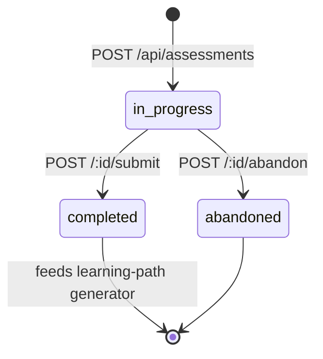
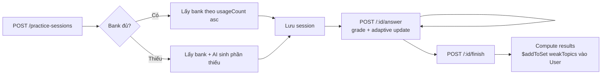

# Week 4: Backend API Completion

## Overview

Hoàn tất phần backend của AI Learning Assistant: thêm Subject catalog, Assessment, Practice Session, User Profile, và đổi credential. Sau Week 4 backend đã sẵn sàng cho frontend (Week 5+) gọi đầy đủ.

## Files Created / Modified

```
backend/src/
├── controllers/
│   ├── subject.controller.ts          # NEW — list/get
│   ├── assessment.controller.ts       # NEW — create/list/get/submit/abandon/delete
│   ├── practice-session.controller.ts # NEW — full lifecycle + analytics
│   └── user.controller.ts             # NEW — profile + goals + currentLevel
├── routes/
│   ├── subject.routes.ts              # NEW — public read-only
│   ├── assessment.routes.ts           # NEW
│   ├── practice-session.routes.ts     # NEW
│   ├── user.routes.ts                 # NEW
│   └── auth.routes.ts                 # MODIFIED — + PATCH /password, /email
├── services/
│   ├── auth.service.ts                # MODIFIED — + changePassword, changeEmail
│   ├── assessment-grader.service.ts   # NEW — pure grading helpers
│   ├── practice-grader.service.ts     # NEW — adaptive + results
│   └── practice-question-selector.service.ts  # NEW — bank-first + AI fallback
├── scripts/
│   └── seed-subjects.ts               # NEW — idempotent catalog seed
├── models/
│   ├── question.model.ts              # MODIFIED — enum reduced to multiple_choice
│   └── assessment.model.ts            # MODIFIED — status += abandoned
└── types/
    ├── ai.types.ts                    # MODIFIED — questionType literal
    └── index.ts                       # MODIFIED — narrow types
```

## 1. Endpoint Summary

| Method | Endpoint | Auth | Description |
|--------|----------|------|-------------|
| GET | `/api/subjects` | — | List curated subjects (catalog) |
| GET | `/api/subjects/:id` | — | Get subject incl. topics |
| POST | `/api/assessments` | ✓ | Create entry test (409 if in-progress exists) |
| GET | `/api/assessments` | ✓ | List user's assessments (filter by subject/status) |
| GET | `/api/assessments/:id` | ✓ | Get assessment (key hidden until completed) |
| POST | `/api/assessments/:id/submit` | ✓ | Submit answers, auto-grade |
| POST | `/api/assessments/:id/abandon` | ✓ | Abandon in-progress |
| DELETE | `/api/assessments/:id` | ✓ | Delete |
| POST | `/api/practice-sessions` | ✓ | Start practice (409 if in-progress exists) |
| GET | `/api/practice-sessions` | ✓ | List sessions |
| GET | `/api/practice-sessions/:id` | ✓ | Get session |
| GET | `/api/practice-sessions/analytics/weak-topics` | ✓ | Weak topics with names |
| POST | `/api/practice-sessions/:id/answer` | ✓ | Submit single answer + adaptive |
| POST | `/api/practice-sessions/:id/finish` | ✓ | Finish + update user weak-topics |
| POST | `/api/practice-sessions/:id/abandon` | ✓ | Abandon in-progress |
| PATCH | `/api/users/me` | ✓ | Update profile |
| PUT | `/api/users/me/learning-goals` | ✓ | Replace goals array |
| POST | `/api/users/me/learning-goals` | ✓ | Append goal |
| DELETE | `/api/users/me/learning-goals/:subjectId` | ✓ | Remove goal |
| PATCH | `/api/users/me/current-level` | ✓ | Set current subject level |
| PATCH | `/api/auth/password` | ✓ | Change password |
| PATCH | `/api/auth/email` | ✓ | Change email |

## 2. Subject Catalog

Catalog là dữ liệu cố định, seed qua script — không có CRUD qua API.

### Seed
```bash
cd backend
npm run seed:subjects
```

Insert 4 môn (Toán THPT, IELTS, Lập trình Python, Tiếng Anh giao tiếp). Idempotent — chạy lại không tạo trùng, không đổi `_id` của topic.

### Read
```bash
curl http://localhost:5000/api/subjects
curl http://localhost:5000/api/subjects?withTopics=true
curl http://localhost:5000/api/subjects/<id>
```

## 3. Assessment Lifecycle



### Tạo bài
```bash
curl -X POST http://localhost:5000/api/assessments \
  -H "Authorization: Bearer $TOKEN" \
  -H "Content-Type: application/json" \
  -d '{"subjectId":"<sid>","difficulty":2,"questionCount":10}'
```
- Nếu user còn 1 bài `in_progress` cùng `subjectId` → `409` với `data.existingId`.
- Nếu `topicIds` rỗng → mặc định lấy toàn bộ topics của subject.
- AI sinh câu hỏi qua `question-generator.service`. Lỗi AI → `502`.
- Response giấu `correctAnswer` và `options[].isCorrect`.

### Nộp bài
```bash
curl -X POST http://localhost:5000/api/assessments/<id>/submit \
  -H "Authorization: Bearer $TOKEN" \
  -H "Content-Type: application/json" \
  -d '{"answers":[{"questionId":"<qid>","answer":"B","timeSpentSeconds":30}]}'
```
- Chấm tự động (so chuỗi với snapshot's `correctAnswer`).
- Tính `skillAnalysis` (correct/total/level theo từng topic) và `recommendedLevel` (mode của level).
- Status → `completed`. Submit lại → `409`.

### Liên kết với Learning Path
`learning-path-generator.service` đọc `assessment.results.skillAnalysis`:
- `strengths` = topic có ratio > 0.7
- `weaknesses` = topic có ratio < 0.5
- `currentLevel` = `recommendedLevel`

## 4. Practice Session Lifecycle



### Start
```bash
curl -X POST http://localhost:5000/api/practice-sessions \
  -H "Authorization: Bearer $TOKEN" \
  -H "Content-Type: application/json" \
  -d '{"topicIds":["<tid>"],"mode":"adaptive","settings":{"questionCount":10,"difficultyRange":[1,3]}}'
```
- 409 nếu user còn session `in_progress` (global, không phân môn).
- Bank-first: ưu tiên Question có `usageCount` thấp nhất; chỉ gọi AI khi thiếu.

### Trả lời từng câu
```bash
curl -X POST http://localhost:5000/api/practice-sessions/<id>/answer \
  -H "Authorization: Bearer $TOKEN" \
  -H "Content-Type: application/json" \
  -d '{"questionId":"<qid>","answer":"B","timeSpentSeconds":15}'
```
Response: `{ isCorrect, explanation, currentDifficulty }`. Adaptive: 2 đúng liên tiếp → diff++, 2 sai → diff-- (bound [1,3]).

### Kết thúc
```bash
curl -X POST http://localhost:5000/api/practice-sessions/<id>/finish \
  -H "Authorization: Bearer $TOKEN"
```
- Idempotent: gọi lại trên session đã `completed` trả nguyên kết quả cũ.
- Topic có ratio < 0.5 → đẩy vào `User.currentLevel.weakTopics` qua `$addToSet`.

### Phân tích yếu
```bash
curl http://localhost:5000/api/practice-sessions/analytics/weak-topics \
  -H "Authorization: Bearer $TOKEN"
```
Trả về `weakTopics: [{ topicId, topicName, subjectName, subjectCode }]`.

## 5. User Profile & Credentials

### Sửa profile
```bash
curl -X PATCH http://localhost:5000/api/users/me \
  -H "Authorization: Bearer $TOKEN" \
  -H "Content-Type: application/json" \
  -d '{"profile":{"name":"Phương","grade":"12"}}'
```

### Đặt mục tiêu học
```bash
curl -X PUT http://localhost:5000/api/users/me/learning-goals \
  -H "Authorization: Bearer $TOKEN" \
  -H "Content-Type: application/json" \
  -d '{"goals":[{"subjectId":"<sid>","targetLevel":"intermediate","targetDate":"2026-08-01"}]}'
```
- Tối đa 10 goals; cấm trùng `subjectId`; verify subjectId tồn tại.

### Đổi mật khẩu
```bash
curl -X PATCH http://localhost:5000/api/auth/password \
  -H "Authorization: Bearer $TOKEN" \
  -H "Content-Type: application/json" \
  -d '{"currentPassword":"old","newPassword":"newPass123"}'
```
- Sai `currentPassword` → 401. New password tối thiểu 8 ký tự.
- JWT cũ vẫn dùng được tới khi hết hạn (chấp nhận cho MVP).

### Đổi email
```bash
curl -X PATCH http://localhost:5000/api/auth/email \
  -H "Authorization: Bearer $TOKEN" \
  -H "Content-Type: application/json" \
  -d '{"password":"current","newEmail":"new@example.com"}'
```
- Yêu cầu password để chống session-hijack. Email đã có user khác → 409.

## 6. Conventions

### Response envelope
```json
{ "success": true, "data": { ... } }
{ "success": false, "message": "...", "errors": [...] }
```

### Status codes
- `200` OK, `201` Created
- `400` Validation / bad input
- `401` Auth / wrong credential
- `404` Not found / not own
- `409` Conflict (in-progress duplicate, email taken, goal trùng subject)
- `502` AI generation failed

### Question type
Toàn hệ thống chỉ còn `multiple_choice`. `fill_blank` và `essay` đã loại khỏi enum, type, prompt, Swagger.

### Single-in-progress rule
- Assessment: 1 in-progress / (user, subject)
- Practice: 1 in-progress / user (toàn cục)
- Cả 2 trả 409 với `data.existingId` để frontend redirect resume hoặc gọi `/abandon`.

## 7. Decisions Log

| # | Decision | Rationale |
|---|----------|-----------|
| 1 | Subject catalog: seed + read-only | KISS — không cần admin role layer |
| 2 | Đổi password/email gộp Phase 5 | Cùng surface với profile |
| 3 | `/api-docs` để public | MVP/đồ án — review lại trước commercial |
| 4 | Chỉ giữ `multiple_choice` | Đơn giản hóa grading, bỏ branching essay |
| 5 | 1 in-progress / user (assessment per subject, practice global) | UX rõ; có abandon endpoint thoát |

## 8. Test checklist

- [x] `npm run build` pass sau mỗi phase
- [x] Seed chạy 2 lần không trùng + giữ topic `_id`
- [ ] Smoke E2E: register → seed → assessment create+submit → learning-path → practice start+answer+finish → weak-topics → change password → login lại với mật khẩu mới
- [ ] `/api-docs` UI render 5 tag groups (Auth, Users, Subjects, Questions, Assessments, Practice Sessions, Learning Paths)

## 9. Out of Scope

- Token versioning để invalidate JWT cũ khi đổi password
- Rate-limit middleware cho credential endpoints
- Avatar upload (chỉ chấp nhận URL string)
- Password reset qua email
- Admin role / admin UI
