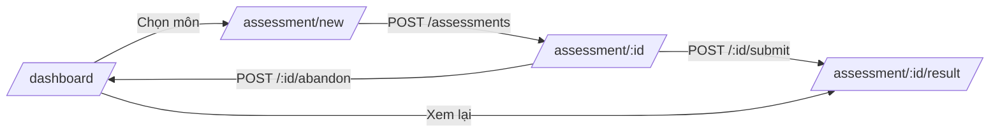

# BÁO CÁO TUẦN 5 — Giao diện cơ bản (Frontend)

| | |
|---|---|
| **Đề tài** | AI Learning Assistant — Web hỗ trợ học tập cá nhân hóa |
| **Sinh viên** | Trần Đỗ Lan Phương |
| **MSV** | B23DCCN667 |
| **Giảng viên hướng dẫn** | TS. Nguyễn Xuân Đức |
| **Tuần** | 5 |

---

## 1. Mục tiêu tuần

- Cấu hình HTTP client (Axios) + lưu JWT trong localStorage.
- Xây dựng trang Đăng ký / Đăng nhập sử dụng `/api/auth`.
- Dashboard hiển thị môn học, danh sách bài đánh giá / lộ trình / phiên luyện tập.
- Luồng làm bài đánh giá: chọn môn → AI sinh câu hỏi → trả lời → nộp → xem kết quả.

---

## 2. Công việc đã thực hiện

### 2.1 Cấu trúc frontend

```
frontend/src/
├── app/
│   ├── layout.tsx                       # Bọc AuthProvider toàn app
│   ├── page.tsx                         # Landing — redirect theo trạng thái auth
│   ├── login/page.tsx
│   ├── register/page.tsx
│   ├── dashboard/page.tsx
│   └── assessment/
│       ├── new/page.tsx                 # Bắt đầu bài mới
│       └── [id]/
│           ├── page.tsx                 # Làm bài
│           └── result/page.tsx          # Xem kết quả
├── components/
│   ├── app-header.tsx
│   ├── protected-route.tsx
│   └── ui/                              # shadcn (button, card, input, badge, separator)
└── lib/
    ├── api-client.ts                    # Axios instance + JWT interceptor
    ├── api-services.ts                  # Hàm gọi API gom theo nhóm
    ├── auth-context.tsx                 # React Context cho user
    └── types.ts                         # TS interface khớp backend
```

### 2.2 API client + JWT

`api-client.ts` tạo 1 instance Axios duy nhất với:
- `baseURL` lấy từ `NEXT_PUBLIC_API_URL` (mặc định `http://localhost:5000/api`).
- Request interceptor: tự động đính `Authorization: Bearer <token>` nếu có token trong localStorage.
- Response interceptor: nhận 401 → tự xóa token (UI quyết định redirect).
- Helper `getErrorMessage()` chuẩn hóa lỗi từ backend (`message`, `errors[]`).

`api-services.ts` gom các nhóm `authApi`, `subjectApi`, `assessmentApi`, `learningPathApi`, `practiceApi` — mỗi method `unwrap` envelope `{ success, data }` để component không phải bóc 2 lớp.

### 2.3 Auth context

`AuthProvider` quản lý:
- `user` (full shape từ `/auth/me`).
- `loading` (đang rehydrate).
- `login(email, password)`, `register(email, password, name)`, `logout()`.

**Lưu ý hợp đồng:** Backend `/auth/login` và `/auth/register` trả về `user: { id, email, name }` (phẳng), trong khi `/auth/me` trả `{ id, email, profile: { name }, learningGoals, currentLevel }`. Để component chỉ cần đọc 1 shape duy nhất, sau khi login/register, context **gọi tiếp `/auth/me`** lấy bản đầy đủ.

`ProtectedRoute` bọc các trang yêu cầu đăng nhập; chờ `loading` xong, nếu không có user → `router.replace('/login')`.

### 2.4 Trang Đăng ký / Đăng nhập

- Validate client tối thiểu (email format, password ≥ 6 ký tự) — backend là nguồn validation chính.
- Hiển thị lỗi từ `getErrorMessage(err)` để bắt cả lỗi Zod (`errors[].message`) lẫn lỗi trực tiếp (`message`).
- Sau khi auth thành công → `router.replace('/dashboard')`.
- Nếu user đã có session, vào lại `/login` hoặc `/register` sẽ tự bounce sang `/dashboard`.

### 2.5 Dashboard

Tải song song 4 nguồn (`Promise.all`):
- `subjects` — danh sách môn để bắt đầu bài đánh giá mới (mỗi môn 1 card).
- `assessments` — danh sách bài đã / đang làm với status badge.
- `learningPaths` — best-effort (không có API trả mảng rỗng cũng OK).
- `practiceSessions` — tương tự.

Ô bài đánh giá điều hướng theo status:
- `in_progress` → `/assessment/:id` (tiếp tục).
- `completed` → `/assessment/:id/result`.
- `abandoned` → trang chi tiết.

### 2.6 Luồng làm bài đánh giá



**`/assessment/new`** — chọn môn (mặc định lấy từ query `?subjectId=...`), độ khó (1–3), số câu (5–20). Khi nhấn "Bắt đầu" → gọi `POST /assessments`. Nếu backend trả 409 với `existingId` (đã có bài dở) → hiện nút "Tiếp tục bài đang dở" deep-link tới đó.

**`/assessment/[id]`** — hiển thị 1 câu/lần với progress bar. State `answers` là object `{ questionId → optionId }`. Đáp án không bị lộ (backend đã `stripAnswerKey` khi `in_progress`). Có nút Nộp bài (chỉ hiện ở câu cuối) và Hủy bài (gọi `/abandon`).

**`/assessment/[id]/result`** — sau khi nộp:
- Điểm tổng (0–100), số câu đúng, trình độ đề xuất.
- Phân tích theo từng topic (progress bar `correct/total`).
- Review từng câu: highlight xanh đáp án đúng, đỏ lựa chọn sai của user, kèm explanation.

### 2.7 Stack & quy ước

| Tầng | Công nghệ |
|---|---|
| Framework | Next.js 16.1 (App Router, Turbopack) |
| Language | TypeScript strict |
| Styling | Tailwind CSS v4 + shadcn/ui (new-york style) |
| HTTP | Axios |
| State | React Context (auth), local state cho từng trang |
| Routing | App Router với dynamic `[id]` + `Promise<params>` (Next 15+) |

---

## 3. Kết quả đạt được

- 8 route được build & prerender thành công:
  - `/`, `/login`, `/register`, `/dashboard` (static)
  - `/assessment/new`, `/assessment/[id]`, `/assessment/[id]/result` (dynamic theo id)
- `npm run build` pass, 0 lỗi TypeScript / 0 cảnh báo.
- Token JWT được lưu trong localStorage và tự đính vào mọi request.
- Lỗi 401 → tự hủy token, ProtectedRoute redirect login.
- Toàn bộ UI tiếng Việt, responsive trên mobile (Tailwind grid + flex).

---

## 4. Khó khăn / Vấn đề gặp phải

- **Hợp đồng auth không nhất quán:** `/auth/login|register` trả user phẳng `{ id, email, name }` nhưng `/auth/me` trả nested `{ profile: { name } }`. Nếu set state trực tiếp từ login response, mọi component đọc `user.profile.name` sẽ crash. **Giải pháp:** sau login/register, context gọi tiếp `/auth/me` để chuẩn hóa shape — tốn 1 request thêm nhưng tránh lan code phòng vệ khắp UI.
- **Next.js 15+ params là Promise:** Trang `[id]` không thể dùng `params.id` trực tiếp; phải `use(params)` (React hook) trong client component. Đã wrap `Suspense` cho `useSearchParams` ở trang `/assessment/new` để tránh lỗi prerender.
- **Conflict bài đang dở (409):** Khi user nhấn "Bắt đầu" lần 2, backend trả 409 + `existingId`. Đã bắt riêng để hiện nút deep-link "Tiếp tục bài đang dở" thay vì chỉ in lỗi.
- **Đáp án lộ qua snapshot:** Backend đã `stripAnswerKey` cho `in_progress` — nên frontend không cần ẩn thủ công, chỉ cần chuyển sang trang result sau khi `submit` để xem `correctAnswer`.

---

## 5. Hướng tuần tiếp theo

- Tuần 6 — **Dashboard analytics + Practice flow:**
  - Trang chi tiết Lộ trình học (milestone breakdown, đánh dấu hoàn thành).
  - Trang Practice Session (làm bài luyện tập, adaptive difficulty real-time).
  - Phân tích điểm yếu (`/api/practice-sessions/analytics/weak-topics`) hiển thị biểu đồ.
  - Trang Profile: đổi mật khẩu, đổi email, quản lý mục tiêu học (`PUT/POST/DELETE /api/users/me/learning-goals`).
- Bổ sung loading skeleton thay cho text "Đang tải..." để UX mượt hơn.
- Thêm middleware Next.js để chặn route protected ngay từ server (giảm flash login).

---

## 6. Phụ lục

### Cách chạy

```bash
# Backend (terminal 1)
cd backend
npm run dev          # cần MongoDB + ANTHROPIC_API_KEY trong .env

# Frontend (terminal 2)
cd frontend
npm run dev          # mặc định http://localhost:3000
```

Mặc định frontend gọi `http://localhost:5000/api`. Đổi qua `.env.local`:
```env
NEXT_PUBLIC_API_URL=http://localhost:5000/api
```

### Smoke test luồng chính

1. Mở `/register` → tạo tài khoản.
2. Tự redirect `/dashboard` (chưa có dữ liệu).
3. Trên dashboard chọn 1 môn → `/assessment/new` → "Bắt đầu" (chờ AI ~10s).
4. Trả lời từng câu → "Nộp bài" → trang `/result` hiển thị điểm + phân tích.
5. Quay lại `/dashboard` → bài đánh giá đã có badge "Hoàn thành".
6. "Đăng xuất" → token bị xóa, các route protected tự đẩy về `/login`.

### Quyết định kỹ thuật

| # | Quyết định | Lý do |
|---|---|---|
| 1 | Axios thay vì fetch native | Interceptor pattern, message lỗi đồng nhất, được nêu trong kế hoạch Tuần 4 |
| 2 | localStorage thay vì cookie | KISS — chưa cần SSR auth, MVP đồ án |
| 3 | React Context thay vì state lib | YAGNI — auth state nhỏ, không cần Zustand/Redux |
| 4 | Gọi `/me` sau login | Shape mismatch giữa login response và me response |
| 5 | ProtectedRoute là client guard | Đơn giản, đủ cho MVP; tuần sau có thể thêm middleware server-side |
